<div align="center">


# Deen
### Belajar Islam Jadi Menyenangkan

**Platform pembelajaran Islami interaktif untuk membantu santri TPA belajar secara terstruktur, membangun kebiasaan positif, dan memantau progres belajarnya.**

[🌐 Buka Aplikasi](https://web-deen.vercel.app/) · [💻 Repository](https://github.com/arhmath/Deen-Project) · [🐞 Laporkan Masalah](https://github.com/arhmath/Deen-Project/issues)

<br />


</div>

---

## Tentang Deen

Deen adalah platform web pembelajaran Islami yang dirancang dengan pendekatan **belajar, berlatih, dan melihat perkembangan**. Platform ini menggabungkan materi pembelajaran, kuis, gamifikasi, ruang belajar, pemantauan progres, serta asisten AI dalam satu pengalaman digital.

Deen dikembangkan untuk membantu proses belajar terasa lebih terarah dan menarik, sekaligus memberi guru dan orang tua cara untuk mendampingi perkembangan santri sesuai peran dan akses masing-masing.

> **Gagasan utama:** pembelajaran agama tidak cukup hanya menyajikan materi. Pengalaman belajar juga perlu membantu pengguna menjaga konsistensi, berlatih, dan memahami perkembangan belajarnya.

## Masalah yang ingin dijawab

Dalam kegiatan belajar, penyampaian materi saja belum tentu cukup untuk menjaga keterlibatan santri dan membantu pendamping memantau prosesnya. Deen mencoba menjawab tantangan tersebut melalui beberapa pendekatan:

| Tantangan | Pendekatan Deen |
|---|---|
| Aktivitas belajar terasa monoton | Materi, kuis, poin pengalaman (XP), level, streak, dan reward untuk mendukung motivasi |
| Perkembangan belajar sulit dilihat secara ringkas | Dashboard dan informasi progres belajar |
| Aktivitas belajar perlu dikelola bersama | Ruang belajar, kode bergabung, dan fitur pengelolaan kelas |
| Guru membutuhkan gambaran perkembangan santri | Dashboard dan fitur pemantauan untuk guru/admin |
| Orang tua membutuhkan konteks perkembangan anak | Fitur penghubung orang tua–santri dan tampilan progres sesuai otorisasi |
| Pengguna memerlukan bantuan saat menjelajahi platform | Asisten AI Ziya dengan pembatasan domain dan sumber pengetahuan yang dikonfigurasi |

Pendekatan tersebut merupakan **tujuan desain produk**, bukan klaim bahwa dampak pembelajaran telah terbukti secara empiris. Efektivitasnya tetap perlu dievaluasi melalui pengujian bersama pengguna.

## Fitur utama

### 1. Pengalaman belajar santri

- **Dashboard pembelajaran** untuk melihat ringkasan aktivitas dan progres.
- **Kursus dan modul** untuk mengakses materi pembelajaran secara terstruktur.
- **Kuis dan penyelesaian materi** sebagai bagian dari aktivitas belajar.
- **Gamifikasi** melalui XP/poin, level, streak, dan riwayat reward.
- **Leaderboard** global maupun berdasarkan ruang belajar.
- **Ruang belajar** yang dapat diikuti menggunakan kode gabung.
- **Profil santri** dan fitur peta/petualangan yang tersedia pada aplikasi.

### 2. Pengelolaan pembelajaran oleh guru/admin

- Dashboard ringkasan dan pemantauan santri.
- Pengelolaan ruang belajar dan anggota.
- Pengelolaan kursus serta konten pembelajaran.
- Pemantauan data santri.
- Pengelolaan permintaan tautan orang tua–santri sesuai kewenangan.

### 3. Pendampingan orang tua

- Melihat daftar santri yang telah terhubung.
- Membuka detail dan progres belajar santri.
- Mengajukan tautan orang tua–santri untuk persetujuan pihak berwenang.

### 4. Ziya — asisten AI Deen


Ziya adalah karakter asisten yang menjadi bagian dari pengalaman Deen. Implementasi avatar memiliki beberapa aset visual untuk kondisi interaksi seperti idle, clicked, loading, dan typing. Widget chat memanfaatkan layanan chat yang sudah ada, bukan membuat jalur AI terpisah.

Kemampuan AI yang disiapkan pada backend meliputi:

- **Retrieval-Augmented Generation (RAG)** untuk mengambil konteks dari knowledge base Deen dan materi kursus yang diizinkan.
- **Domain guard** untuk membatasi topik sesuai ruang lingkup aplikasi.
- **Prompt-injection guard** sebagai lapisan mitigasi terhadap instruksi yang berusaha menyalahgunakan model.
- **Pilihan provider**: `local`, `openai`/endpoint OpenAI-compatible, atau `anthropic`, bergantung konfigurasi.
- **Chat publik untuk pengunjung** melalui endpoint khusus dengan pembatasan akses dan rate limit berbasis IP.
- **Chat terautentikasi** yang menggunakan sesi dan otorisasi backend.

**Catatan kepercayaan:** guard bukan jaminan bahwa semua jawaban pasti benar atau semua serangan dapat dicegah. Jawaban AI perlu diperlakukan sebagai bantuan, bukan pengganti guru atau rujukan keagamaan yang tepercaya. Konten keagamaan idealnya ditinjau oleh pendidik/ahli yang kompeten.

<div align="center">
  <sub>Aset avatar Ziya yang tersedia di repository:</sub><br />
  
  
  
  
</div>

## Galeri aplikasi

**Lihat versi yang berjalan:** [web-deen.vercel.app](https://web-deen.vercel.app/)

| Halaman | Nama berkas | Uraian |
|---|---|---|
| Landing page | `public/screenshots/landing.png` | Identitas produk, manfaat utama, dan CTA |
| Dashboard santri | `public/screenshots/dashboard-santri.png` | Ringkasan belajar, progres, XP/streak bila tersedia |
| Kursus atau materi | `public/screenshots/learning.png` | Struktur kursus, modul, dan materi |
| Detail materi | `public/screenshots/learning-detail.png` | Isi kursus, modul, dan materi |
| Kuis atau progres | `public/screenshots/quiz-progress.png` | Interaksi belajar dan hasil/progres |
| Ruang belajar | `public/screenshots/learning-room.png` | Kelas, anggota, atau alur bergabung |
| Leaderboard | `public/screenshots/leaderboard.png` | Peringkat dan indikator gamifikasi |
| Asisten Ziya | `public/screenshots/ziya-chat.png` | Avatar, pertanyaan, jawaban, dan sumber/konteks bila ditampilkan |
| Dashboard guru/admin | `public/screenshots/teacher-dashboard.png` | Pengelolaan kelas atau pemantauan santri |
| Tampilan orang tua | `public/screenshots/parent-progress.png` | Hubungan santri dan progres yang diizinkan |

#### 1. Landing Page

Halaman utama yang memperkenalkan Deen, manfaat platform, serta ajakan untuk mulai belajar.

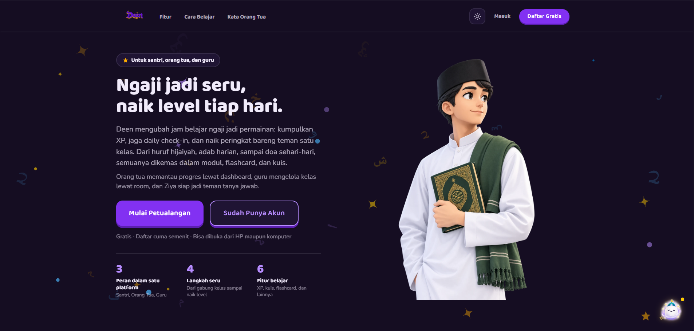

#### 2. Dashboard Santri

Ringkasan aktivitas belajar dan progres santri, termasuk indikator XP atau streak apabila tersedia.

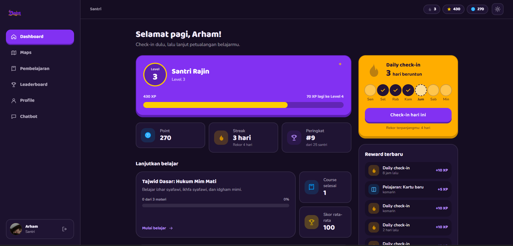

#### 3. Kursus dan Materi Pembelajaran

Halaman untuk menjelajahi kursus, modul, serta materi pembelajaran yang tersedia.

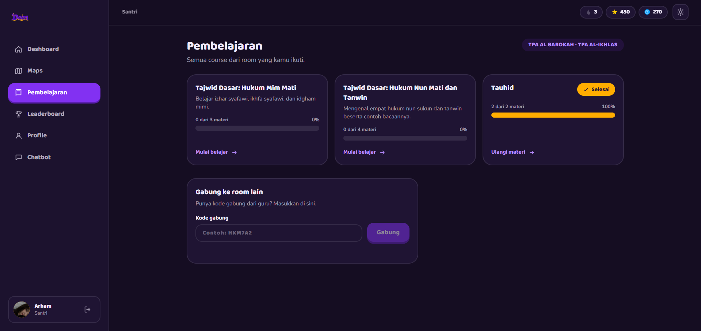

#### 4. Detail Materi

Tampilan materi yang digunakan santri untuk mengikuti proses pembelajaran.

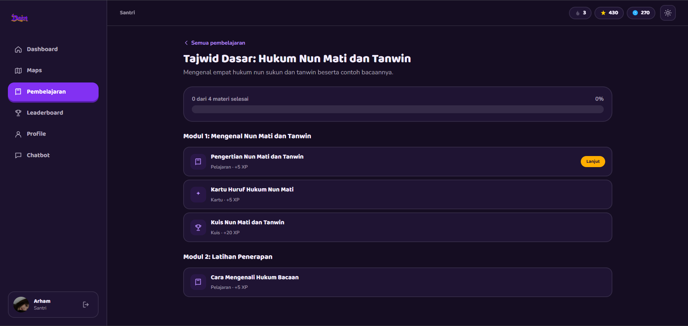

#### 5. Kuis dan Progres Belajar

Halaman interaksi kuis dan informasi hasil atau progres pembelajaran yang tersedia pada aplikasi.

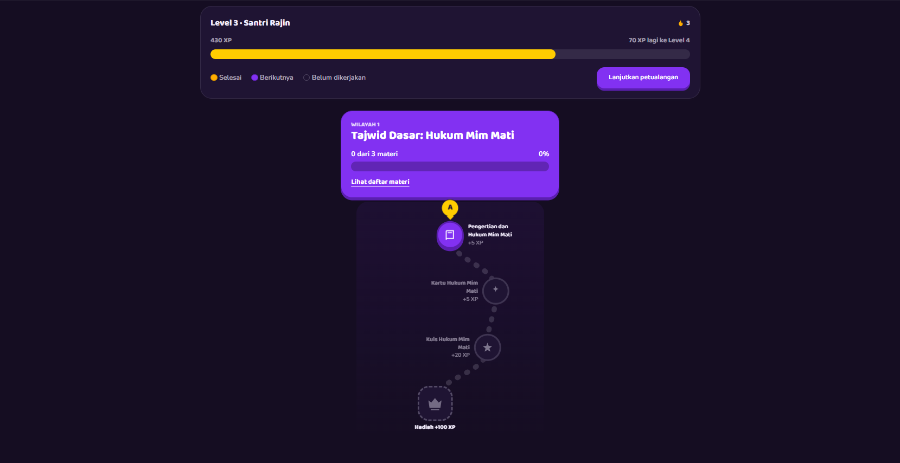

#### 6. Ruang Belajar

Fitur ruang belajar untuk mendukung aktivitas pembelajaran dalam kelas, termasuk informasi anggota dan alur bergabung jika tersedia.

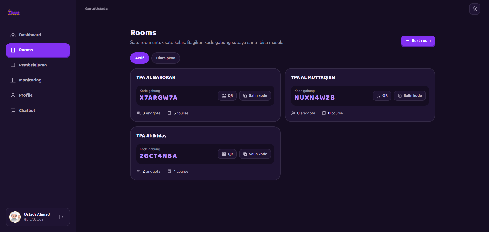

#### 7. Leaderboard dan Gamifikasi

Halaman peringkat untuk menampilkan pencapaian belajar dan indikator gamifikasi yang diterapkan dalam aplikasi.

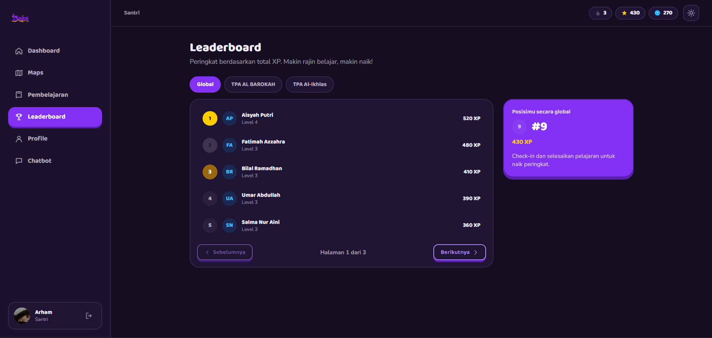

#### 8. Asisten AI Ziya

Tampilan asisten AI Ziya yang mendukung interaksi belajar melalui percakapan. Tampilkan sumber atau konteks jawaban hanya jika memang tersedia pada antarmuka.

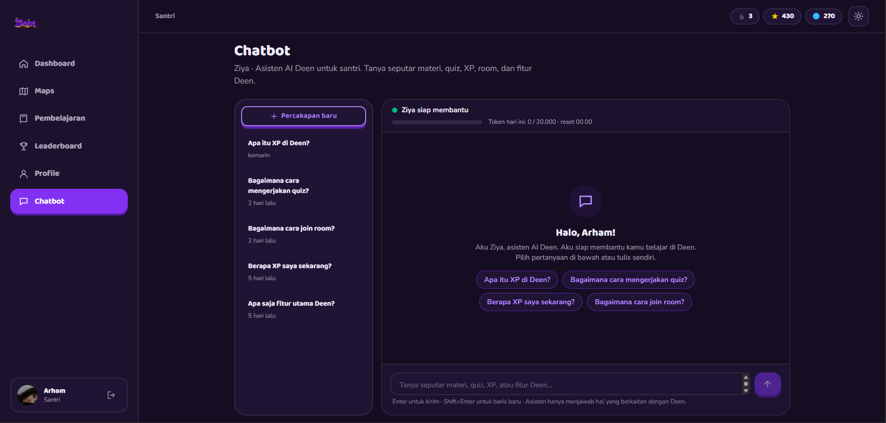

#### 9. Dashboard Guru dan Admin

Antarmuka pendidik untuk mengelola ruang belajar dan memantau aktivitas santri sesuai hak akses.

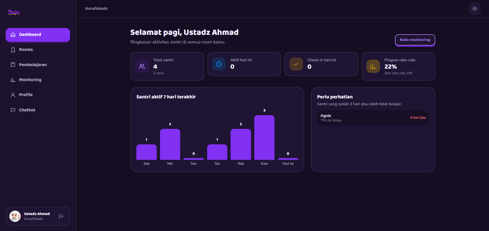

#### 10. Progres Belajar Orang Tua

Tampilan informasi progres santri yang dapat diakses orang tua melalui hubungan akun yang telah diizinkan.

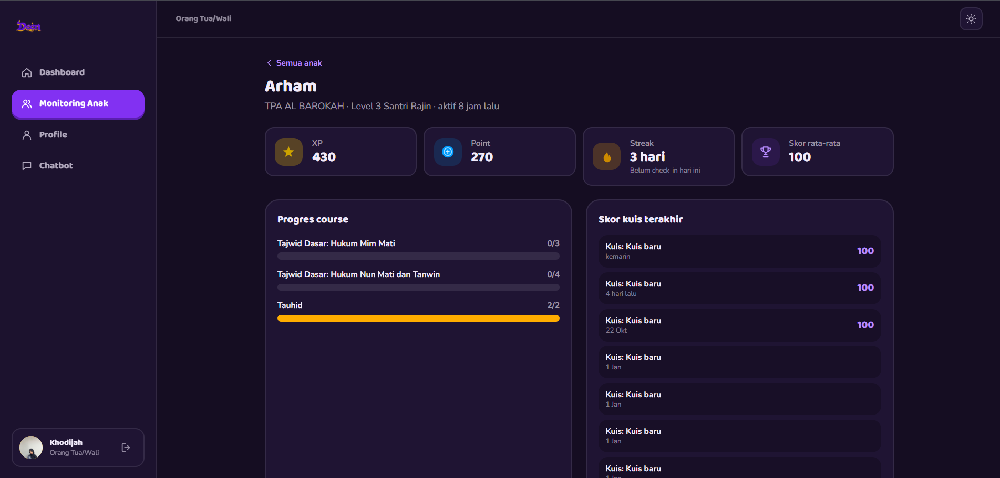

## Alur penggunaan

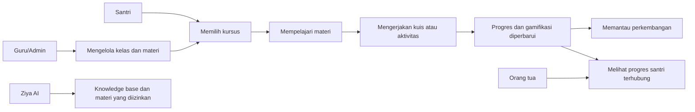

Alur dan hasil yang tersedia dapat berbeda menurut role, konfigurasi backend, data yang sudah disiapkan, dan mode aplikasi. Diagram ini menjelaskan alur konseptual produk, bukan hasil pengukuran efektivitas pembelajaran.

## Teknologi yang digunakan

| Lapisan | Teknologi | Peran |
|---|---|---|
| Frontend | React 19, TypeScript, Vite 8 | Antarmuka aplikasi web |
| Routing | React Router | Navigasi halaman |
| Styling | Tailwind CSS v4 | Sistem styling UI |
| Animasi | GSAP, Framer Motion | Animasi dan transisi antarmuka |
| Form & validasi | React Hook Form, Zod | Pengelolaan dan validasi input |
| Data fetching | TanStack Query | Pengelolaan request dan cache data |
| Backend API | Next.js Route Handlers, TypeScript | Endpoint dan logika server |
| Database | Firebase Admin SDK, Cloud Firestore | Penyimpanan data backend |
| Autentikasi | JWT (`jose`), `bcryptjs` | Token sesi dan hashing password |
| Media/avatar | Cloudinary (opsional, sesuai konfigurasi) | Pengelolaan aset media |
| Email | Nodemailer (sesuai konfigurasi SMTP) | Pengiriman email, termasuk alur reset password |
| AI | Provider lokal, OpenAI-compatible, Anthropic | Pemrosesan asisten AI |
| Pengujian backend | Vitest | Pengujian otomatis |

Versi dependency yang sebenarnya tercantum di `package.json` dan `backend/package.json`. Daftar teknologi tidak berarti seluruh integrasi aktif pada setiap deployment.

## Gambaran arsitektur

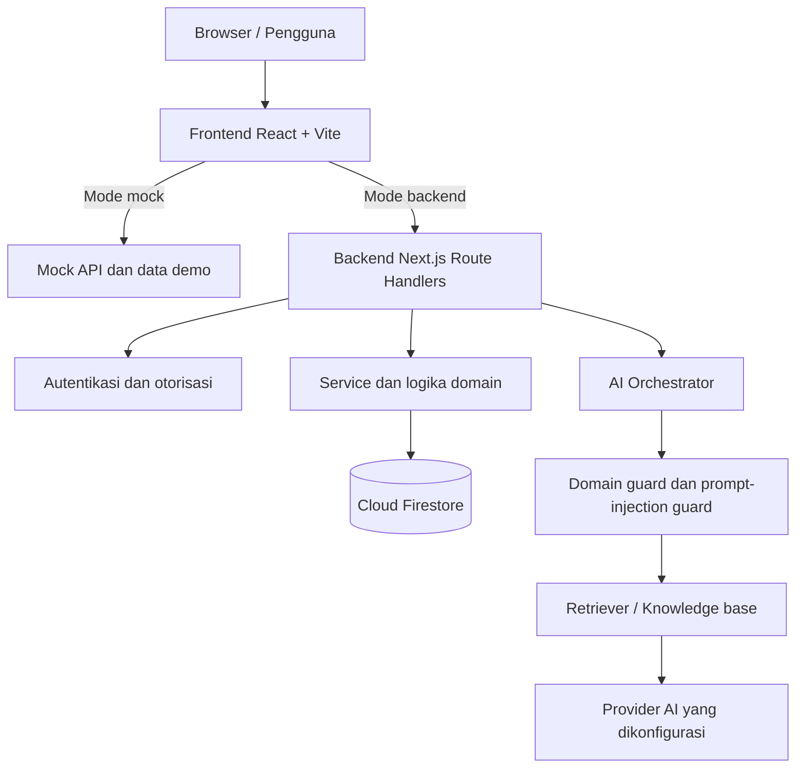

Frontend menggunakan satu pintu request di `src/services/api.ts`. Secara default, `VITE_USE_MOCK` aktif kecuali diatur menjadi string `"false"`. Mode mock membantu demonstrasi UI, sedangkan mode backend mengirim request HTTP ke API yang dikonfigurasi.

Backend menggunakan Firebase Admin SDK untuk mengakses Firestore. Akses data sensitif seharusnya tetap melewati backend dengan pemeriksaan autentikasi dan otorisasi; kredensial server tidak boleh dimasukkan ke bundle frontend.

## Struktur repository

```text
.
├── public/                   # Logo, ilustrasi, avatar Ziya, aset publik
├── src/
│   ├── app/                  # Provider dan konfigurasi aplikasi
│   ├── components/           # Komponen UI dan layout
│   ├── features/             # Fitur berdasarkan domain
│   ├── pages/                # Halaman pengguna dan pembelajaran
│   ├── services/             # API client, layanan fitur, mock
│   └── lib/                  # Utilitas dan validasi
├── backend/
│   ├── scripts/              # Seed, smoke test, dan utilitas
│   └── apps/api/
│       ├── src/app/api/      # Route handlers
│       ├── src/ai/           # Orkestrasi AI, guard, retrieval, tools
│       ├── tests/            # Pengujian backend
│       ├── data/             # Data knowledge base
│       └── .env.example      # Template environment backend
├── package.json              # Script frontend
└── README.md
```

## Menjalankan proyek secara lokal

### Prasyarat

- Node.js yang kompatibel dengan Vite 8 dan Next.js 16; gunakan versi LTS yang didukung dan cocok dengan environment proyek.
- npm.
- Untuk backend sungguhan: Firebase/Cloud Firestore atau Firestore Emulator.
- API key provider eksternal hanya jika memilih provider AI yang memerlukannya.

Periksa instalasi:

```bash
node --version
npm --version
```

### A. Jalankan frontend dalam mode demo/mock

```bash
git clone https://github.com/arhmath/Deen-Project.git
cd Deen-Project
npm install
```

Buat `.env` di root:

```dotenv
VITE_USE_MOCK=true
VITE_API_URL=http://localhost:3001/api/v1
```

Jalankan frontend:

```bash
npm run dev
```

Buka URL yang ditampilkan Vite, biasanya `http://localhost:5173`.

### B. Jalankan backend

Buka terminal kedua:

```bash
cd backend
npm install
cp apps/api/.env.example apps/api/.env
```

Di Windows PowerShell, gunakan `Copy-Item apps/api/.env.example apps/api/.env`.

Isi konfigurasi yang diperlukan di `backend/apps/api/.env`. Minimal, siapkan secret JWT yang kuat dan berbeda untuk access token dan refresh token, lalu konfigurasi Firebase/Firestore Emulator. Jangan menyalin secret produksi ke repository.

Contoh membuat secret acak:

```bash
node -e "console.log(require('crypto').randomBytes(48).toString('base64url'))"
```

Jalankan backend:

```bash
npm run dev
```

Backend lokal menggunakan port `3001`. Endpoint pemeriksaan yang disediakan:

- `GET http://localhost:3001/api/health`
- `GET http://localhost:3001/api/ready`

### C. Hubungkan frontend ke backend

Atur `.env` frontend di root:

```dotenv
VITE_USE_MOCK=false
VITE_API_URL=http://localhost:3001/api/v1
```

Pastikan `CORS_ORIGIN` pada `backend/apps/api/.env` mengizinkan origin frontend, misalnya:

```dotenv
CORS_ORIGIN=http://localhost:5173
```

Restart frontend setelah mengubah environment variable Vite. Untuk kembali ke mode demo, set `VITE_USE_MOCK=true`.

## Konfigurasi penting

### Frontend — `.env` di root

| Variabel | Kegunaan |
|---|---|
| `VITE_USE_MOCK` | `true` untuk mock; `false` untuk backend sungguhan |
| `VITE_API_URL` | Base URL API, misalnya `http://localhost:3001/api/v1` |

Semua variabel `VITE_*` dapat terekspos ke browser. **Jangan menyimpan password, private key, atau API secret di environment frontend.**

### Backend — `backend/apps/api/.env`

Gunakan `backend/apps/api/.env.example` sebagai daftar konfigurasi terbaru. Variabel penting mencakup:

- **App & CORS:** `NODE_ENV`, `APP_TIMEZONE`, `CORS_ORIGIN`, `APP_URL`
- **Autentikasi:** `JWT_ACCESS_SECRET`, `JWT_REFRESH_SECRET`, `ACCESS_TOKEN_TTL_MIN`, `REFRESH_TOKEN_TTL_DAYS`, `BCRYPT_COST`
- **Firebase:** `FIREBASE_PROJECT_ID`, `FIREBASE_CLIENT_EMAIL`, `FIREBASE_PRIVATE_KEY` atau `FIRESTORE_EMULATOR_HOST`
- **Email:** `SMTP_HOST`, `SMTP_PORT`, `SMTP_USER`, `SMTP_PASS`, `MAIL_FROM`
- **Avatar/media:** `CLOUDINARY_CLOUD_NAME`, `CLOUDINARY_API_KEY`, `CLOUDINARY_API_SECRET`
- **AI:** `AI_PROVIDER`, `AI_API_KEY`, `AI_MODEL`, `AI_BASE_URL`, `AI_TIMEOUT_MS`, `AI_RAG_TOP_K`, `AI_RAG_MIN_SCORE`
- **Seed admin:** `SUPERADMIN_SEED_USERNAME`, `SUPERADMIN_SEED_PASSWORD`, `SUPERADMIN_SEED_EMAIL`, `SUPERADMIN_SEED_NAME`

Lihat komentar pada `.env.example` untuk aturan format dan opsi yang lebih lengkap. Jangan commit file `.env`, file service account, atau kredensial lain.

## Pengujian dan pemeriksaan kualitas

Jalankan dari root frontend:

```bash
npm run build
npm run lint
```

Jalankan dari folder `backend`:

```bash
npm test
npm run typecheck
npm run smoke
```

Script yang tersedia juga mencakup seed data dan utilitas verifikasi email. Periksa `backend/package.json` sebelum menjalankannya, dan gunakan database pengembangan untuk proses seed.

## Keamanan, privasi, dan batasan

- Jangan pernah commit file `.env`, service account Firebase, password, token, atau API key.
- Jika secret pernah terunggah, cabut dan rotasi secret tersebut. Menghapusnya dari commit terbaru tidak menghapusnya dari riwayat Git.
- Gunakan HTTPS dan konfigurasi CORS yang spesifik untuk deployment.
- Pastikan pemeriksaan role dan kepemilikan data dilakukan di server, bukan hanya dengan menyembunyikan elemen UI.
- Uji alur autentikasi, reset password, pembatasan akses, rate limit, dan penanganan error sebelum demo publik.
- Mode mock digunakan untuk pengembangan/demo dan bukan bukti bahwa persistensi atau keamanan backend produksi sudah teruji.
- AI dapat memberikan jawaban tidak akurat. Evaluasi kualitas jawaban, retrieval, prompt injection, privasi, dan pembatasan domain sebelum penggunaan luas.
- Jangan menggunakan data pribadi santri pada screenshot atau data demo yang dipublikasikan.

## Status dan ruang pengembangan

Deen merupakan proyek yang masih berkembang. Ketersediaan fitur bergantung pada branch, konfigurasi environment, data, dan deployment yang digunakan.

Arah pengembangan yang relevan untuk tahap berikutnya:

- Pengujian usability bersama santri dan guru dengan persetujuan yang sesuai.
- Evaluasi apakah gamifikasi membantu konsistensi belajar, bukan hanya meningkatkan aktivitas klik.
- Evaluasi kualitas jawaban AI dengan kumpulan pertanyaan yang ditinjau pendidik/ahli.
- Pengukuran ketepatan retrieval dan penanganan pertanyaan yang tidak memiliki sumber memadai.
- Audit keamanan role, relasi orang tua–santri, autentikasi, dan data pengguna.
- Pengujian aksesibilitas, performa, serta responsivitas pada perangkat sasaran.

## Tim dan kontribusi

| Anggota | Peran | Kontribusi |
|---|---|---|
| Arham Athillah | Frontend Developer | Mengembangkan antarmuka pengguna (UI) dan pengalaman pengguna (UX) Deen, mengimplementasikan halaman dan komponen interaktif, mengintegrasikan navigasi aplikasi, serta menghubungkan antarmuka dengan layanan API untuk mendukung alur pembelajaran santri. |
| Ahmad Zamroni T | Backend & AI Developer | Mengembangkan layanan backend, database dan API, mengimplementasikan pengelolaan data serta autentikasi pengguna, mengintegrasikan layanan AI Ziya untuk mendukung pembelajaran interaktif, dan mengembangkan mekanisme pemrosesan respons AI sesuai konteks pembelajaran Deen.. |


## Lisensi

MIT License

Copyright (c) 2026 Deen Project Contributors

Permission is hereby granted, free of charge, to any person obtaining a copy
of this software and associated documentation files (the "Software"), to deal
in the Software without restriction, including without limitation the rights
to use, copy, modify, merge, publish, distribute, sublicense, and/or sell
copies of the Software, and to permit persons to whom the Software is
furnished to do so, subject to the following conditions:

The above copyright notice and this permission notice shall be included in all
copies or substantial portions of the Software.

THE SOFTWARE IS PROVIDED "AS IS", WITHOUT WARRANTY OF ANY KIND, EXPRESS OR
IMPLIED, INCLUDING BUT NOT LIMITED TO THE WARRANTIES OF MERCHANTABILITY,
FITNESS FOR A PARTICULAR PURPOSE AND NONINFRINGEMENT. IN NO EVENT SHALL THE
AUTHORS OR COPYRIGHT HOLDERS BE LIABLE FOR ANY CLAIM, DAMAGES OR OTHER
LIABILITY, WHETHER IN AN ACTION OF CONTRACT, TORT OR OTHERWISE, ARISING FROM,
OUT OF OR IN CONNECTION WITH THE SOFTWARE OR THE USE OR OTHER DEALINGS IN THE
SOFTWARE.

---

<div align="center">

**Deen — Ubah rasa bosan jadi semangat belajar, setiap hari.**

*Dibangun untuk membuat pengalaman belajar lebih terarah, interaktif, dan mudah dipantau.*

</div>
